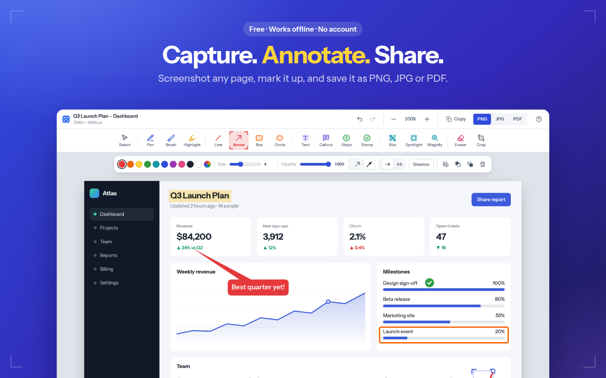
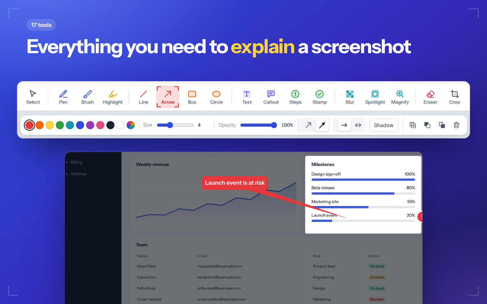
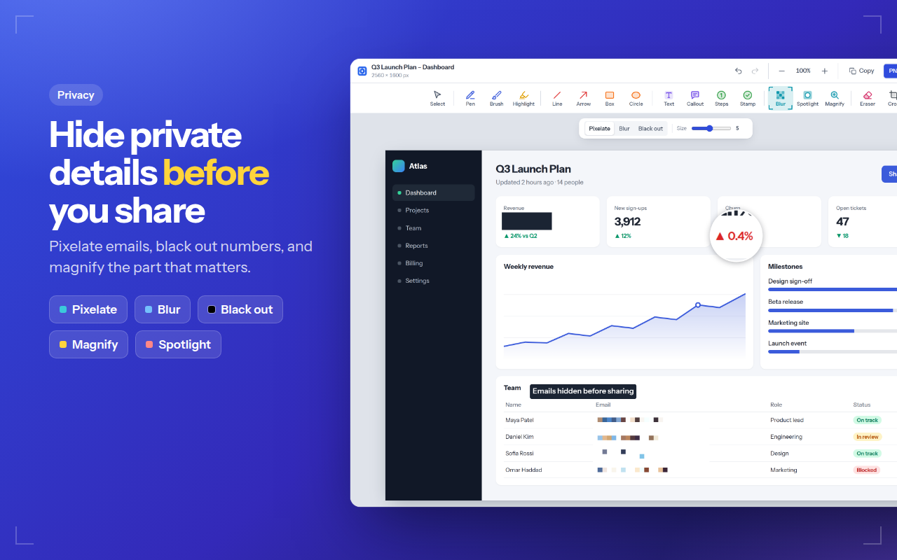
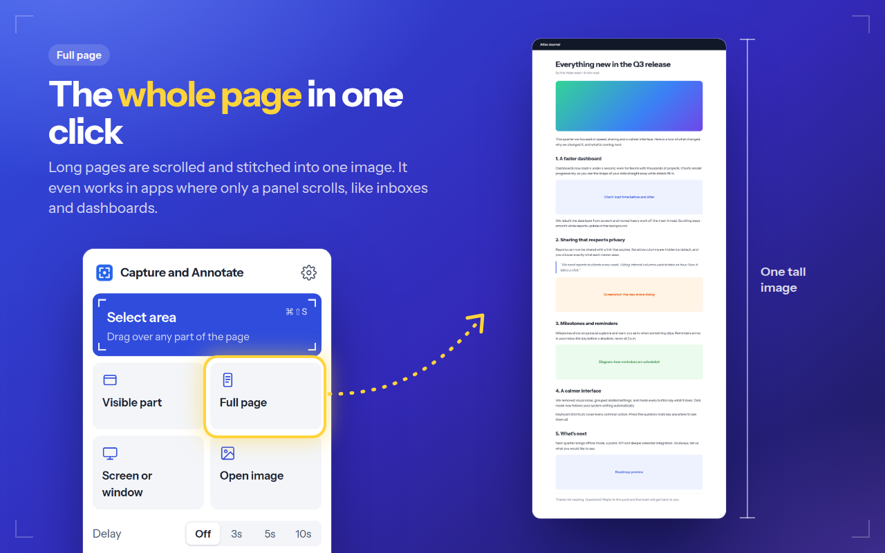

# Capture and Annotate

A browser extension for **Chrome and Firefox** that captures any part of a page, a full scrolling page or any window on your screen. You can then mark it up with arrows, text, numbered steps and blur, and save it as **PNG, JPG or PDF**. It works offline, with no account and no tracking.

## Features

**Capture**
- **Select area**: <kbd>Ctrl</kbd>+<kbd>Shift</kbd>+<kbd>S</kbd> (<kbd>⌘</kbd>+<kbd>Shift</kbd>+<kbd>S</kbd> on Mac). Drag to select, <kbd>Enter</kbd> for the whole screen, <kbd>Esc</kbd> to cancel.
- **Visible part** and **Full page**. Full page scrolls and stitches the page, and sticky headers appear only once. In apps where only a panel scrolls (Gmail, Slack, Notion, dashboards), it scrolls that panel and captures all of it.
- **Screen or window**: capture another app, a whole monitor or another tab.
- **Delay** of 3, 5 or 10 seconds, to capture menus and hover states.
- **Right-click menu** on any page, plus the toolbar popup and keyboard shortcuts.
- **Open image**: annotate any image you drop, paste or choose.

**Annotate**
- **Draw:** pen, brush (gets thinner as you move faster, and follows pen pressure), and highlighter (freehand or box).
- **Shapes:** line, arrow (classic or tapered, one or two heads), rectangle and ellipse. Drag the middle of a line or arrow to curve it.
- **Explain:** text, callout bubbles that point at something, numbered steps (they renumber automatically) and stamps (tick, cross, star, heart and more).
- **Focus and hide:** spotlight (dims everything else), magnifier, and blur, pixelate or black out for private info.
- **Style:** 10 colours plus a custom colour, size and opacity sliders, no fill, light fill or solid fill, solid, dashed or dotted lines, and drop shadows. Each tool remembers its last style.
- Everything stays editable: select an annotation to move, resize, recolour, duplicate, reorder or delete it. Double-click text to edit it. The eraser removes whole annotations.
- Undo and redo, crop, zoom, and <kbd>Shift</kbd> to snap lines to 45° or draw perfect squares and circles.

**Save**
- PNG, JPG, or PDF (A4, Letter, or one long page), or copy to the clipboard.
- Settings for what happens after a capture (open the editor, save right away or copy), the default format and the quality.

Press <kbd>?</kbd> in the editor to see every shortcut.

## Screenshots

| | |
| --- | --- |
|  |  |
|  |  |

## Try it locally

**Chrome, Edge or Brave**
1. Open `chrome://extensions` and turn on **Developer mode**.
2. Click **Load unpacked** and pick this folder.

**Firefox**
1. Run `node scripts/build.mjs`.
2. Open `about:debugging#/runtime/this-firefox`, click **Load Temporary Add-on** and pick `dist/firefox/manifest.json`.

## Build for the stores

```
node scripts/build.mjs
```

This creates `dist/chrome/`, `dist/firefox/` and a zip for each store:

- `dist/capture-and-annotate-chrome-<version>.zip` goes to the [Chrome Web Store](https://chrome.google.com/webstore/devconsole) (also works for the Edge Add-ons store).
- `dist/capture-and-annotate-firefox-<version>.zip` goes to [Firefox Add-ons](https://addons.mozilla.org/developers/).

The root `manifest.json` is the Chrome version. The build script adapts it for Firefox: it switches to a background script, adds the add-on ID and data-collection declaration, and shortens the name to fit Firefox's 45-character limit.

Before uploading:
- Bump `version` in `manifest.json` for every release.
- Run `npx web-ext lint --source-dir dist/firefox` to check the Firefox build.
- For the privacy section in both stores, state that no data is collected and link to [`PRIVACY.md`](PRIVACY.md).
- The Chrome listing text, screenshots and promo tiles are in [`store/`](store/LISTING.md).

## Project layout

```
manifest.json            Extension manifest (Chrome; build adapts it for Firefox)
src/background.js        Shortcuts, right-click menu, capturing, full-page scrolling
src/inject/select.js     Area-selection overlay injected into the page
src/popup/               Toolbar popup
src/editor/              Editor: tools, editable annotations, zoom, saving
src/screen/              Screen or window capture page
src/options/             Settings page
src/shared/base.css      Colours, type and the crop-mark style shared by all pages
src/lib/pdf.js           Small built-in PDF writer (no dependencies)
src/lib/store.js         Hands captures from the background to the editor (IndexedDB)
src/lib/settings.js      Settings defaults and storage
fonts/                   Instrument Sans (SIL Open Font License)
scripts/build.mjs        Builds Chrome and Firefox packages into dist/
scripts/make-icons.py    Regenerates icons/ (needs Pillow)
test/pdf.test.mjs        Checks generated PDFs with qpdf
store/                   Chrome Web Store artwork and listing text (see store/README.md)
```

There's no build step for development and no third-party code, just plain JavaScript.

## Known limits

- Browsers block extensions on their own pages (`chrome://`, `about:`) and on the extension stores. The toolbar icon shows a red **!** there.
- Full-page capture scrolls either the page or its largest scrolling panel, not several panels at once. Apps that draw their content on a canvas (Google Docs, Google Sheets) and panels inside embedded frames capture only what is visible.
- Pages taller than the browser's canvas limit (about 32,000 px) are scaled down to fit.
